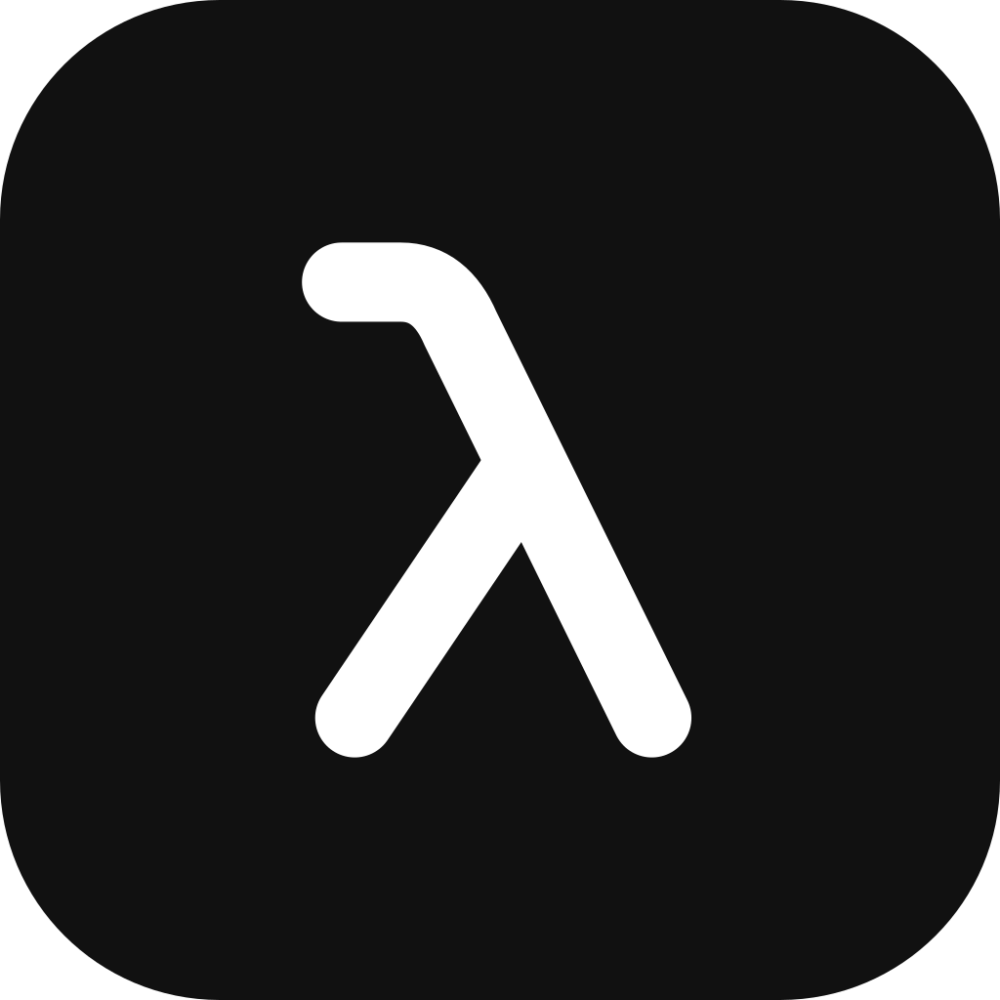
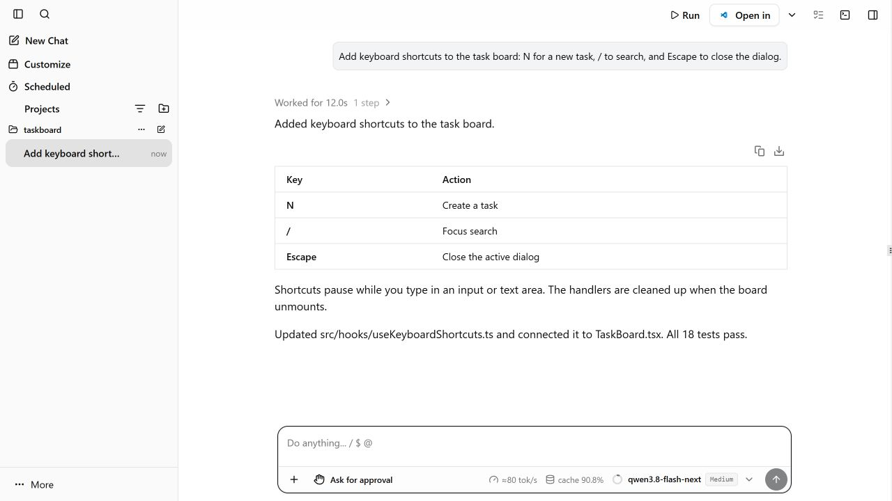

# Codex Lemma

[English](README.md) · [下载安装](https://github.com/liangshaobo2001/codex-lemma/releases) · [源码构建](CONTRIBUTING.md)

Codex Lemma 是一个开源的 Windows 桌面 Codex CLI 图形界面。对话、模型切换、文件编辑、Git 差异和终端放在同一个工作区中，可连接自己部署的本机模型端点。

项目基于 [Codexia v0.58.0](https://github.com/milisp/codexia/tree/v0.58.0) 分叉，使用 React 和 Tauri。这是独立社区项目，与 OpenAI 无隶属关系。

*开发版界面，项目、对话和统计均为演示数据，不含私人会话。*

## 功能

- 流式对话、命令审批、工具执行记录和子代理视图。
- 自定义服务商与模型，在输入框中选择模型。
- 项目工作区、文件编辑与预览、Git 差异、内置终端。
- MCP 连接器、技能、计划任务、待办事项和本机用量统计。
- 中英文界面、明暗主题、紧凑的 Windows 无边框窗口。

此分支移除了上游 Bots、Claude Code、ACP、远程/移动界面、Publish、遥测和自动更新流程。部分内部 Rust crate 仍保留 Codexia 名称。

## 安装与连接本机模型

1. 从 [Releases](https://github.com/liangshaobo2001/codex-lemma/releases/latest) 下载 Windows x64 安装包。
2. 运行安装程序，选择安装目录。需要 WebView2；缺少时安装程序可引导安装。
3. 打开 Lemma，选择项目文件夹。
4. 进入 **设置 → 模型**，添加自定义服务商，填写 Base URL、模型 ID，以及服务端要求的密钥；在输入框中选择该模型。

安装包已包含 **Codex CLI 0.163.0** 及所需辅助程序，使用者无需另装 Node.js 或 Codex。模型服务需要单独准备，本项目不附带模型权重或推理引擎。

端点必须支持 **OpenAI Responses API**，并兼容流式输出及 Codex 使用的工具调用。仅支持 Chat Completions 的端点不能直接使用。例如服务地址是 `http://127.0.0.1:8000/v1/responses`，Base URL 填写 `http://127.0.0.1:8000/v1`，模型 ID 填服务端实际提供的名称。上下文长度也应与服务端一致。

保存设置不代表已验证连接。建议先在临时工作区测试简单对话和无害命令。模型能力、工具调用质量和协议兼容性会影响实际表现。详情见[模型配置与排错](docs/PROVIDERS.md)。

新安装默认使用 **请示批准**：在沙箱内处理工作区操作，遇到需要额外权限的操作时询问你。**替我批准** 则使用 Codex 的 AI 审查员。此前自加的“自动模式”已移除，旧设置会迁移为“请示批准”。

## 配置与数据

默认使用 `%USERPROFILE%\.codex`，因此可能共享已有 Codex 的配置、登录和会话。在 Lemma 中修改模型配置，也可能影响使用同一目录的其他 Codex 客户端。需要独立配置时，在启动前设置 `CODEX_HOME`，见[使用说明](docs/USAGE.md)。

Lemma 自身元数据保存在 `%USERPROFILE%\.codex-lemma`；WebView 数据位于 `%LOCALAPPDATA%\app.codexlemma`。界面中填写的服务商密钥以明文保存到 Codex 配置中，请勿公开配置文件。

推理请求发送给你选择的服务商。选择本机模型不等于整个应用完全离线：Codex、插件目录、连接器和可选下载仍可能联网。详见[隐私说明](docs/PRIVACY.md)。

## 首发范围

0.1.0 为 Windows x64 首发版本，尚未签名；macOS/Linux 安装包、自动更新及远程访问不在本次验证范围内。部分功能依赖所附 CLI 与模型端点的支持，历史轮次读取也可能受 CLI 的 app-server API 限制。

源码构建与验证见 [CONTRIBUTING.md](CONTRIBUTING.md)，打包发布见[发布说明](docs/RELEASING.md)，改动见 [CHANGELOG.md](CHANGELOG.md)。

应用使用 MIT 许可证，保留原 Codexia 版权声明。随附的 Codex CLI 使用 Apache-2.0，附带其 LICENSE 和 NOTICE。见 [LICENSE](LICENSE) 和[第三方声明](THIRD_PARTY_NOTICES.md)。
